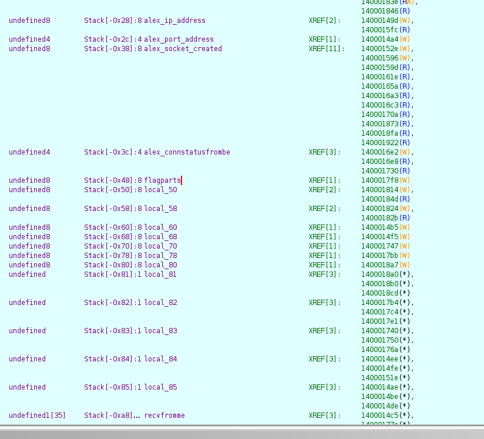
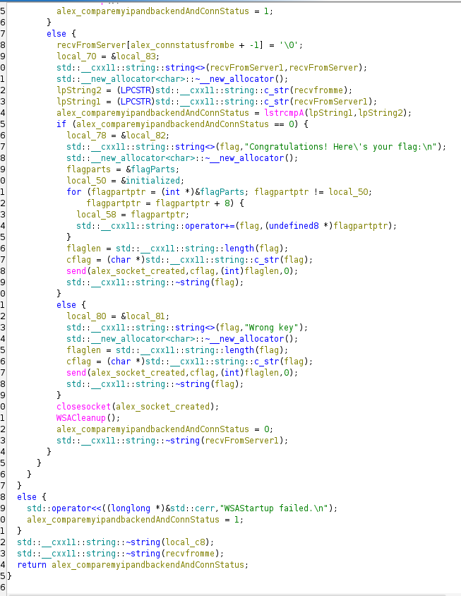
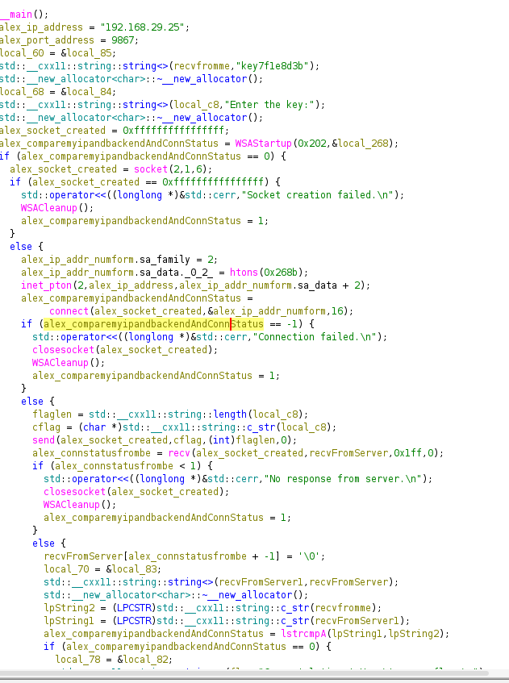

## Binary instrumentation 4 - [LINK]()

I opened it in Ghidra and renamed based on logic I was analyzing.

Once the user's input equals the actual key, at 84, it extracts the flag and sends it to the user.

Main trouble was that the flag's available as a static string in the application. Checked .rdata, and yes it's there. So I just placed the debugger and picked up the flag value. At line 97. Could've just checked the function stack, it was at `ST-0x48`. It was encoded, so tried common decoding it using multiple encodings. And on 1st attempt i.e. base64 found it.

So ... a spoof for a CTF i guess.

